# HeartOps - MLOps Assignment 1 report

## 1. Project overview and architecture

Student: Ankit Bukshete — BITS ID: 2025AE05016. Repository: https://github.com/Ankit-Bukshete/Heart_Disease_Mlops.

HeartOps predicts presence of heart disease from 13 routine clinical attributes in the UCI Cleveland dataset and serves the model as a monitored API. The project covers the full MLOps lifecycle: reproducible data acquisition, EDA, tuned scikit-learn pipelines, MLflow tracking and registry, automated tests, a four-stage GitHub Actions pipeline, a Docker image, a Kubernetes deployment exposed through Ingress, and Prometheus/Grafana monitoring.

The diagram shows the four layers. Training produces one serialized pipeline (preprocessing + classifier) that is the only artifact the API loads, so the transformations used in training and serving are identical by construction.

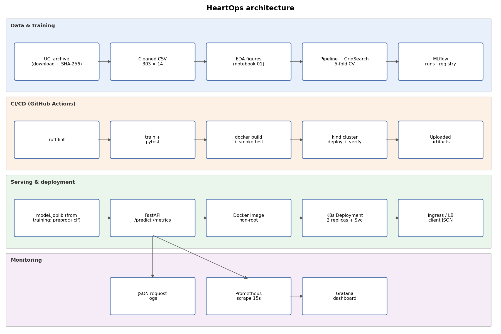

## 2. Data acquisition and cleaning

Source: Janosi, Steinbrunn, Pfisterer and Detrano (1989), Heart Disease, UCI Machine Learning Repository, DOI 10.24432/C52P4X, CC BY 4.0. scripts/download_data.py (via heartops.data.acquire) downloads the official archive, extracts processed.cleveland.data, validates 303 rows and diagnosis codes 0-4, stores the raw SHA-256 (a74b7efa387bc9d1...) and writes data/processed/heart.csv.

Cleaning: "?" markers become NaN (ca: 4, thal: 2 - only 6 cells). Diagnosis 1-4 is mapped to 1 (disease present). Original UCI codes are kept (cp 1-4, slope 1-3, thal 3/6/7). Missing values are deliberately not imputed on the whole dataset; imputation is learned inside each CV fold to avoid leakage.

Class balance: {'0': 164, '1': 139} - roughly 54/46, so accuracy is meaningful, but ROC-AUC is used for model selection.

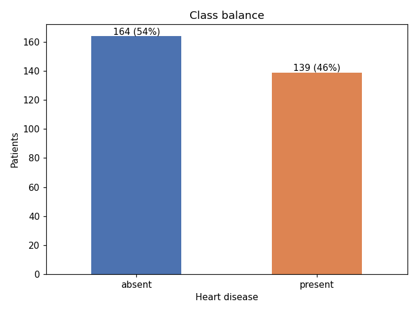

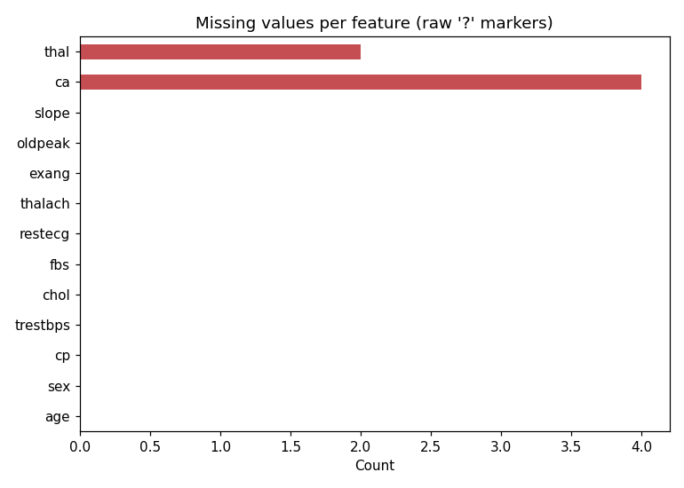

## 3. Exploratory data analysis

Numeric densities by diagnosis show the strongest separation for maximum heart rate (mean 139 with disease vs 158 without) and ST depression (oldpeak 1.6 vs 0.6). Cholesterol and resting blood pressure overlap heavily.

Per-category disease rates are striking: asymptomatic chest pain (cp=4) has a 73% disease rate versus 18-30% for other types; reversible thallium defect (thal=7) 76% versus 22% for normal (thal=3). These motivate one-hot encoding rather than treating codes as ordinal numbers.

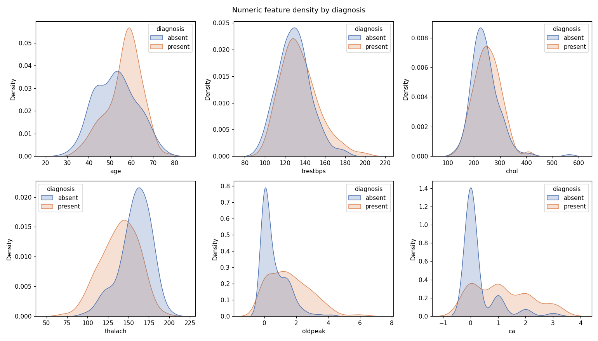

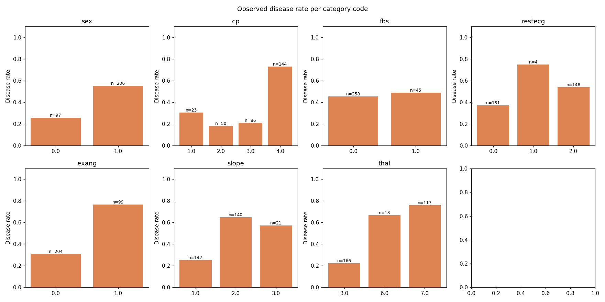

## 4. Feature engineering

Numeric features (age, trestbps, chol, thalach, oldpeak, ca) receive median imputation then StandardScaler. Categorical codes (sex, cp, fbs, restecg, exang, slope, thal) receive most-frequent imputation then one-hot encoding with handle_unknown="ignore". A ColumnTransformer and the classifier form one sklearn Pipeline (src/heartops/model.py), which is fitted inside every CV fold.

Strongest absolute correlations with the target: thal 0.53, ca 0.46, exang 0.43, oldpeak 0.42, thalach -0.42, cp 0.41. No features were dropped: the dataset is small, and regularisation/tree depth handle weak features. EDA is descriptive only and was not used on held-out data.

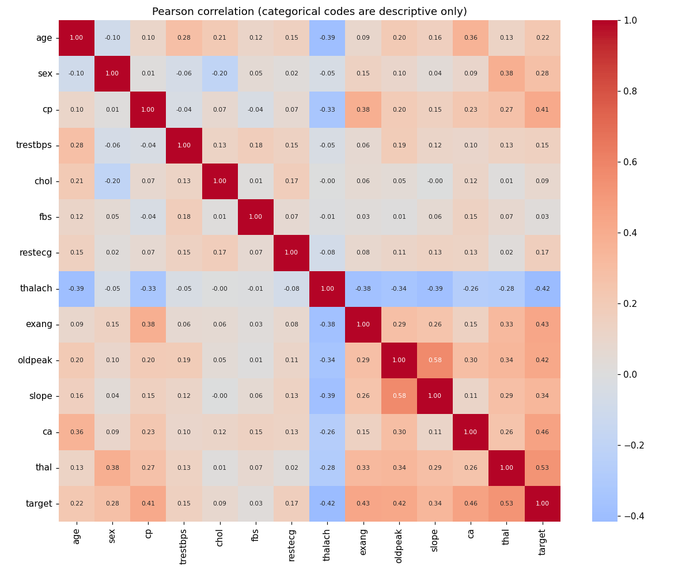

## 5. Model development and tuning

Split: stratified 80/20 with seed 42 - 242 training and 61 held-out patients. 5-fold stratified CV on training patients only, scoring accuracy, precision, recall and ROC-AUC; refit on ROC-AUC.

Grids - logistic: C=[0.01, 0.1, 1.0, 10.0]; class_weight=[None, 'balanced'] (8 configurations) | forest: max_depth=[3, 5, None]; min_samples_leaf=[1, 4] (6 configurations).

logistic: CV ROC-AUC 0.9113 (std 0.0180), accuracy 0.8511, precision 0.8776, recall 0.7921; best {'classifier__C': 0.1, 'classifier__class_weight': None}.

forest: CV ROC-AUC 0.8985 (std 0.0290), accuracy 0.8180, precision 0.8262, recall 0.7739; best {'classifier__max_depth': None, 'classifier__min_samples_leaf': 4}.

Selected: logistic (highest mean CV ROC-AUC). A strongly regularised linear model wins on 242 patients; the forest overfits more (higher train-fold AUC) without better validation AUC. The held-out set never influenced the choice.

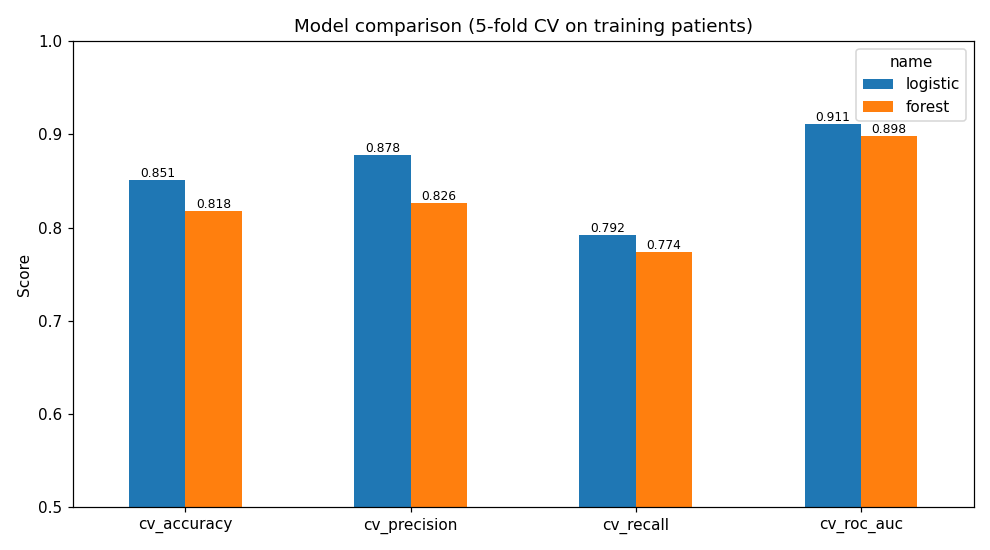

## 6. Evaluation and experiment tracking

Held-out (61 patients, threshold 0.5): accuracy 0.8852, precision 0.8387, recall 0.9286, roc_auc 0.9610. Recall is prioritised clinically (few missed positives); with 61 patients these estimates carry wide uncertainty.

MLflow (SQLite backend, experiment "heartops-cleveland"): one parent run per model family with best parameters, CV metrics, grid CSV, out-of-fold ROC and confusion plots, EDA figures and the fitted pipeline; one nested child run per grid configuration (14 trials); and a final run with held-out metrics, registered as "heartops-classifier" v1 in the Model Registry.

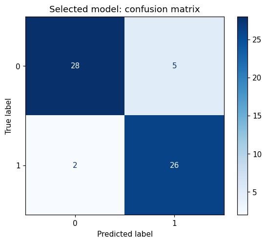

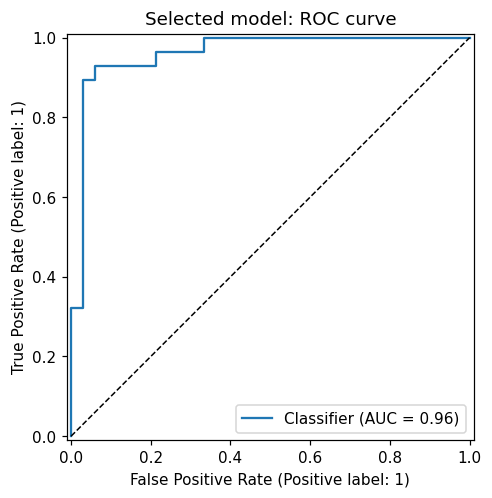

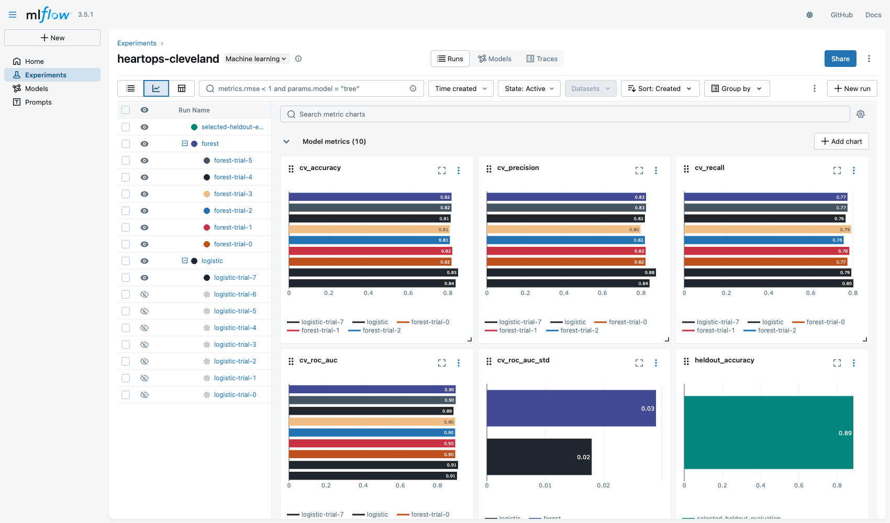

## 7. Packaging, reproducibility and CI/CD

Packaging: artifacts/model.joblib holds the complete pipeline; the same model is logged in MLflow format. requirements.txt pins every direct dependency; seeds (42) and data SHA-256 are recorded in metrics.json and MLflow tags. Clean setup: python -m venv .venv; pip install -r requirements.txt; pip install --no-deps -e .; python -m heartops.train.

Tests (pytest, 16): dataset shape/missingness, provenance, EDA output, scaling and encoding, grid validity, serialization equivalence, API validation and metrics, inference CLI and a ROC-AUC >= 0.80 quality gate.

GitHub Actions (.github/workflows/ci.yml) runs four dependent jobs: lint (ruff) -> train + test (JUnit XML, step summary, report) -> Docker build + HTTP smoke test -> kind deploy + ingress verification. Any failure stops later jobs; logs and artifacts (model, MLflow store, test XML, container and k8s evidence) are uploaded. Run #1 on GitHub passed all four jobs in 7m 8s.

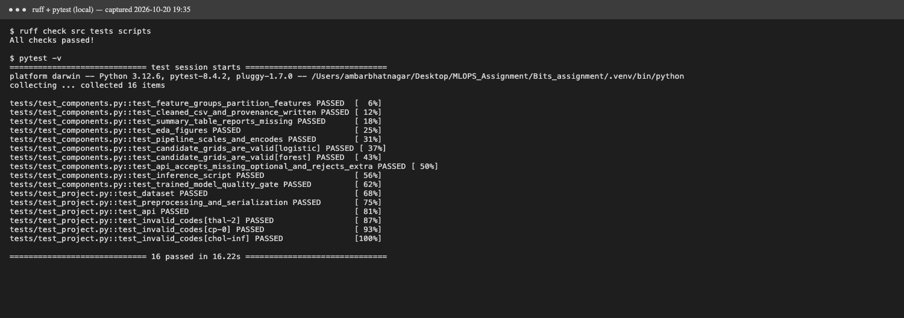

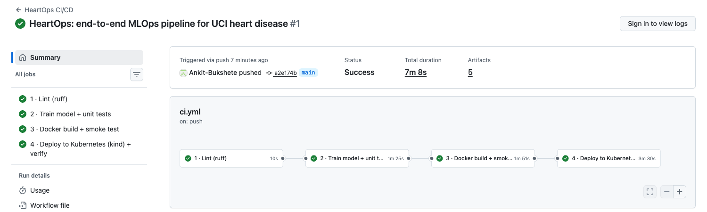

## 8. Model serving and containerization

FastAPI (src/heartops/api.py) loads the pipeline at startup. POST /predict accepts a JSON patient (Pydantic-validated ranges and codes; unknown fields rejected; ca/thal nullable) and returns prediction, disease_probability, confidence (probability of the predicted class) and threshold. /health, /ready, /metrics and /docs support operations. Invalid input returns HTTP 422 without echoing patient data.

The Dockerfile uses python:3.12-slim and runs as non-root UID 10001. The image was built and tested locally: /ready returned model_loaded=true and /predict returned a prediction for examples/patient.json.

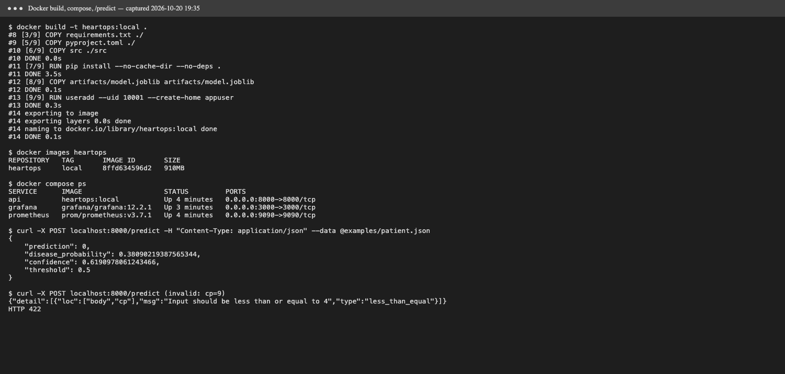

## 9. Production deployment and monitoring

deploy/api.yaml: Deployment (2 replicas, resource limits, non-root securityContext, readiness/liveness probes, Prometheus annotations) and a LoadBalancer Service; deploy/ingress.yaml exposes it via ingress-nginx. scripts/deploy_kind.sh creates a kind cluster, loads the image, deploys and verifies /predict through the ingress at http://localhost:8081 (on kind the LoadBalancer IP stays pending; it is assigned on Docker Desktop, minikube tunnel or a cloud cluster).

Monitoring: every request is logged as JSON (request id, route, status, latency; no patient data). Prometheus scrapes /metrics; the provisioned Grafana dashboard shows request rate, 4xx/5xx rate, p50/p95 latency, predictions per class and mean predicted probability.

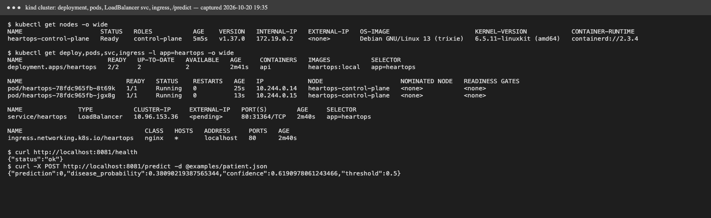

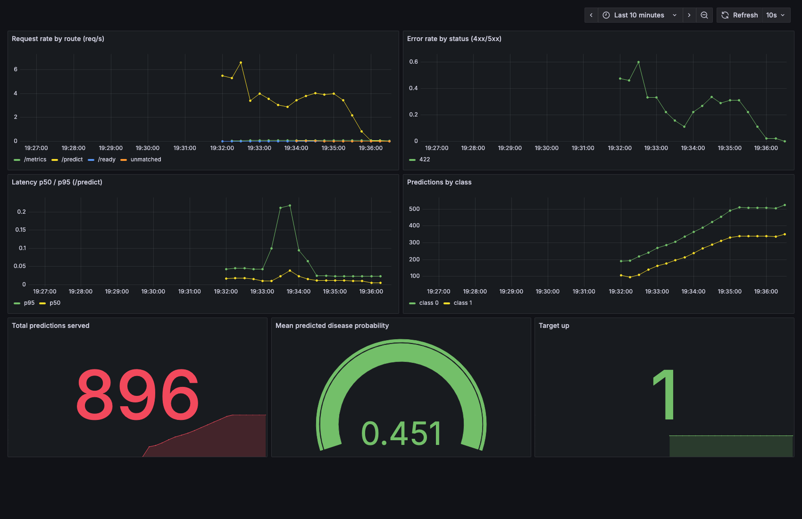

## 10. Submission, access and limitations

Repository: https://github.com/Ankit-Bukshete/Heart_Disease_Mlops. Local access: docker compose up -d --build (API :8000, Prometheus :9090, Grafana :3000) or ./scripts/deploy_kind.sh (ingress :8081). Evidence is in screenshots/, artifacts/ and reports/verification.md.

Notebooks: notebooks/01_eda, 02_training, 03_inference (executed). Inference CLI: scripts/predict.py (local model or --url for the deployed API).

Limitations: 303 historical patients from one centre, no external validation, no probability calibration, no drift or outcome monitoring, and no API authentication. Future work: external validation, calibration, confidence intervals, drift metrics, image registry with signed digests and authenticated ingress. This is a coursework model, not a clinical tool.

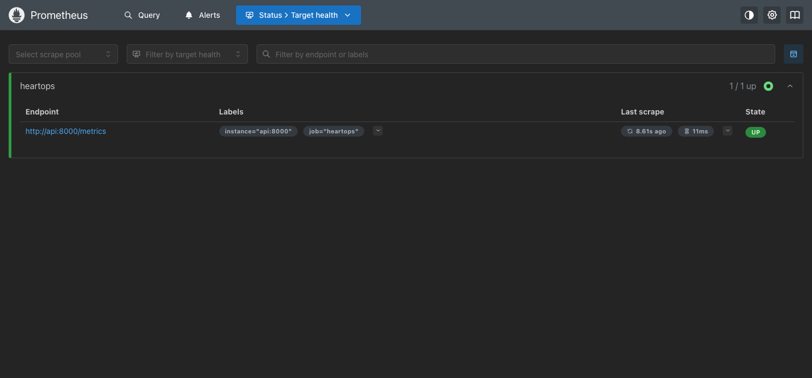
